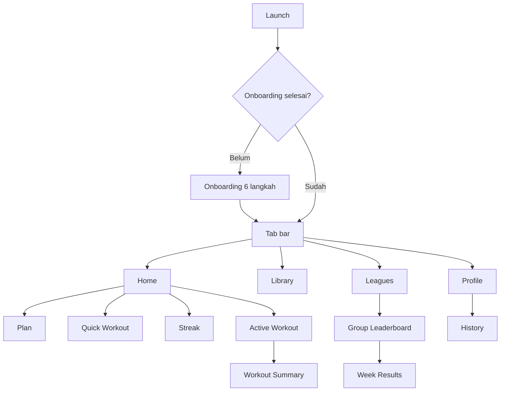
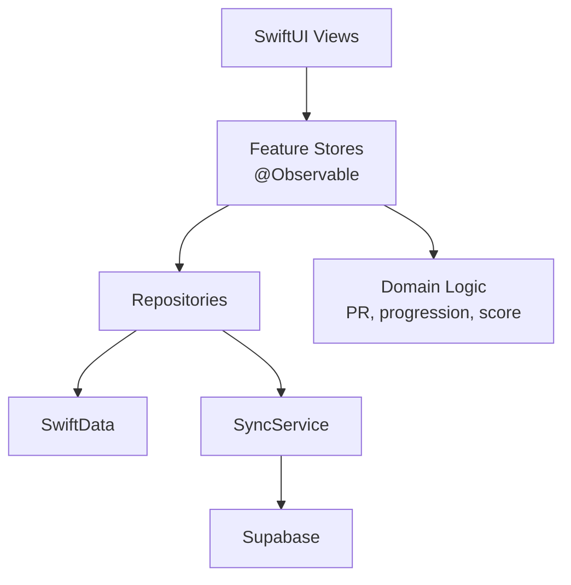

# PRD — Rivalift (iOS Gym Log + Friend Leagues)

Sep 24, 2026 · @plainthing studio · diperbarui 24 Nov 2026

**Perubahan 24 Nov 2026 (beginner rework):** app terasa membingungkan untuk pemula (istilah, program yang tidak konsisten, memilih program sulit). Home sekarang langsung menunjukkan latihan hari ini dari plan yang bernama tujuan (PLAN-01 s.d. PLAN-09), tab History diganti Library (LIB-07) dan riwayat pindah ke Profile, streak pribadi punya rest week (PROG-06, PROG-07), dan ada Quick Workout. Detail teknis di `docs/HANDOFF.md`.

## 1. Ringkasan produk

Rivalift adalah app iOS untuk mencatat latihan gym yang dilengkapi liga mingguan antar teman, dengan skor yang adil untuk semua level kekuatan. Versi pertama menyasar pasar global (bahasa Inggris) dan dibangun native dengan SwiftUI menggunakan Claude Code dan iOS Simulator.

**Nama:** Rivalift. Nama ini belum dipakai app lain di App Store maupun Google Play; domain rivalift.com sudah dipakai pihak lain, jadi gunakan alternatif seperti rivalift.app atau getrivalift.com.

**Visi:** membuat orang tetap konsisten ke gym karena teman-temannya juga ikut, bukan karena motivasi sendiri saja.

**Dua pilar produk:**

- **Gym log yang cepat dan lengkap.** Pencatatan set, beban, dan repetisi, rest timer otomatis, riwayat, rekor pribadi, dan saran beban berikutnya. Tetap berfungsi penuh tanpa koneksi internet.
- **Kompetisi yang adil.** Liga mingguan dalam grup teman dengan tiga mode: Consistency yang adil untuk semua level, Strength untuk adu kekuatan, dan Custom untuk kategori latihan pilihan grup.

## 2. Masalah, pengguna, dan positioning

Kebanyakan orang berhenti ke gym dalam beberapa bulan pertama karena kehilangan motivasi, dan app gym log yang ada hanya membantu mencatat, bukan membuat mereka kembali.

**Masalah yang dipecahkan:**

- Konsistensi bergantung pada motivasi pribadi yang cepat luntur.
- Latihan bersama teman sulit dilakukan karena jadwal berbeda, padahal akuntabilitas sosial terbukti efektif.
- Leaderboard berbasis beban absolut membuat pemula merasa tidak mungkin menang, lalu berhenti ikut.
- Pengguna lupa beban sesi sebelumnya dan tidak tahu kapan harus menaikkan beban.

**Target pengguna utama:**

| Persona | Deskripsi | Kebutuhan utama |
| --- | --- | --- |
| Social lifter | 20–35 tahun, rutin 3–4× per minggu, punya teman atau rekan kerja yang juga ke gym | Motivasi dari persaingan ringan dengan teman |
| Pemula yang serius | Baru 0–12 bulan latihan, ingin membangun kebiasaan | Struktur program dan bukti progres |
| Grup gym | 3–10 orang (teman kantor, teman kampus, komunitas) | Satu tempat untuk saling memantau dan bersaing |

**Positioning:** gym log dengan kompetisi teman yang adil lintas level. Kompetitor utama seperti Hevy dan Strong fokus pada pencatatan dan feed sosial, sedangkan app seperti Strava dan Garmin punya leaderboard yang berbasis angka absolut. Rivalift membedakan diri lewat liga mingguan tertutup antar teman dengan skor berbasis konsistensi dan rekor pribadi.

## 3. Tujuan dan metrik keberhasilan

Tujuan utama MVP adalah membuktikan bahwa kompetisi antar teman menaikkan retensi dibanding pengguna yang berlatih sendiri. Target angka di bawah adalah asumsi awal untuk 90 hari setelah rilis publik, dan perlu dikalibrasi setelah data pertama masuk.

| Metrik | Definisi | Target awal |
| --- | --- | --- |
| Retensi minggu ke-4 | % pengguna yang mencatat ≥1 sesi di minggu ke-4 setelah daftar | ≥ 35% (pengguna dalam grup), ≥ 20% (solo) |
| Pengguna dalam grup | % pengguna aktif yang tergabung di ≥1 grup | ≥ 50% |
| Viral coefficient | Rata-rata pengguna baru yang bergabung lewat undangan per pengguna | ≥ 0,5 |
| Sesi per minggu | Median sesi per pengguna aktif mingguan | ≥ 2,5 |
| Kecepatan input | Median waktu mencentang satu set dari layar latihan | < 5 detik |
| Stabilitas | Crash-free sessions | ≥ 99,5% |

**Bukan tujuan MVP:** monetisasi, pertumbuhan lewat iklan, dan dukungan Android.

## 4. Ruang lingkup MVP

MVP mencakup gym log lengkap yang bekerja offline, satu format kompetisi (liga mingguan dalam grup), dan notifikasi dasar, khusus iOS.

**Termasuk (in scope):**

- Login dengan Apple dan Google, profil singkat, pilihan satuan kg/lb.
- Pencatatan latihan: set, beban, repetisi, tipe set, rest timer otomatis, catatan.
- Library latihan bawaan (±120 gerakan) dan latihan custom.
- Plan bernama tujuan ("Get in Shape", "Build Muscle"…) yang menentukan latihan hari ini, dengan program bawaan sebagai isinya, plus template buatan user.
- Quick Workout: satu latihan untuk hari ini dari alat, waktu, dan fokus yang dipilih.
- Riwayat sesi, grafik progres per latihan, rekor pribadi otomatis.
- Saran beban berikutnya berbasis aturan.
- Grup teman lewat tautan undangan, liga mingguan dengan tiga mode (Consistency, Strength, Custom), leaderboard, hasil akhir minggu.
- Push notification untuk pengingat dan event kompetisi.
- Sinkronisasi log latihan lewat iCloud, ekspor data CSV, hapus akun.

**Tidak termasuk (out of scope, versi berikutnya):**

- Android.
- Tantangan 1 lawan 1 dan target kolektif grup.
- Tingkatan liga dengan promosi dan degradasi.
- Feed aktivitas, komentar, reaksi, dan chat.
- Kartu share ke Instagram Story.
- Widget home screen, Live Activity, dan app Apple Watch.
- Integrasi Apple Health.
- Protein tracker, pengukuran tubuh, dan foto progres.
- Langganan premium dan in-app purchase.
- Leaderboard global atau publik.
- Lokalisasi selain bahasa Inggris (string disiapkan, terjemahan belum).

## 5. Persyaratan fungsional

Setiap persyaratan punya ID agar mudah dirujuk saat memberi tugas ke Claude Code. Prioritas P0 wajib ada di rilis publik pertama; P1 boleh menyusul di update pertama jika waktu tidak cukup.

### 5.1 Onboarding dan akun (AUTH)

| ID | Persyaratan | Prioritas |
| --- | --- | --- |
| AUTH-01 | Login dengan Sign in with Apple | P0 |
| AUTH-02 | Login dengan Google | P1 |
| AUTH-03 | Mode tanpa akun: user bisa langsung mencatat latihan; login baru diminta saat membuat atau bergabung ke grup | P0 |
| AUTH-04 | Profil: nama tampilan (wajib), avatar (foto atau inisial berwarna), satuan kg/lb, target sesi per minggu (1–7, default 3) | P0 |
| AUTH-05 | Onboarding 6 langkah (nama, tujuan, level, satuan, target mingguan dan hari latihan, komitmen streak) lalu rekomendasi plan dari jawaban tersebut (tujuan → plan, lihat PLAN-02) | P0 |
| AUTH-06 | Data lokal yang dibuat sebelum login tetap tersimpan dan terhubung ke akun setelah login | P0 |

**Acceptance criteria:**

- User baru menyelesaikan onboarding dalam ≤ 10 tap (di luar mengetik nama) dan melihat plan yang direkomendasikan beserta alasannya; setelah itu Home langsung menunjukkan latihan hari ini.
- Menutup app di tengah onboarding tidak menghilangkan pilihan yang sudah dibuat.

### 5.2 Pencatatan latihan (LOG)

| ID | Persyaratan | Prioritas |
| --- | --- | --- |
| LOG-01 | Memulai latihan selalu dari pilihan yang jelas, tanpa layar perantara: latihan hari ini dari plan (My Plan), workout buatan sendiri dengan satu tap, "ulangi sesi terakhir", pilih latihan satuan, atau template siap pakai (Custom). Sesi dan durasinya baru mulai setelah user memilih | P0 |
| LOG-02 | Tambah, hapus, dan urutkan ulang latihan dalam sesi (drag) | P0 |
| LOG-03 | Tabel set per latihan: nomor set, kolom "previous", beban, repetisi, tombol centang | P0 |
| LOG-04 | Kolom "previous" menampilkan beban × repetisi set yang sama pada sesi terakhir latihan tersebut; tap untuk mengisi otomatis | P0 |
| LOG-05 | Tipe set: warm-up (W), working (default), drop set (D), failure (F). Warm-up tidak dihitung untuk rekor dan volume | P0 (W, working), P1 (D, F) |
| LOG-06 | Input beban dengan keypad angka, kelipatan 0,5 (kg) atau 1 (lb); repetisi bilangan bulat 0–100. Latihan dumbbell diisi beban per dumbbell, dengan petunjuk "per dumbbell" di header kolom | P0 |
| LOG-07 | Latihan berbasis waktu (plank) dan bodyweight (pull-up dengan beban tambahan opsional) | P1 |
| LOG-08 | Rest timer otomatis mulai saat set dicentang; durasi default per latihan (compound 150 detik, isolation 90 detik), bisa diubah per latihan | P0 |
| LOG-09 | Rest timer tampil sebagai bar melayang di bawah layar dengan tombol −15 detik, +15 detik, lewati; getar dan bunyi saat selesai, termasuk saat app di background (local notification) | P0 |
| LOG-10 | Header sesi: durasi berjalan, total volume, jumlah set selesai | P0 |
| LOG-11 | Catatan teks per latihan dan per sesi | P1 |
| LOG-12 | Selesaikan sesi: layar ringkasan (durasi, volume, jumlah set, rekor baru) lalu simpan | P0 |
| LOG-13 | Sesi aktif tetap tersimpan jika app ditutup paksa atau HP mati, dan bisa dilanjutkan | P0 |
| LOG-14 | Buang sesi dengan konfirmasi | P0 |
| LOG-15 | Edit sesi yang sudah selesai (dalam 7 hari terakhir untuk menjaga keadilan liga) | P1 |

**Acceptance criteria:**

- Seluruh alur pencatatan berjalan dalam mode pesawat tanpa error.
- Mencentang set yang sudah terisi otomatis dari "previous" butuh 1 tap.
- Force quit di tengah sesi lalu membuka app lagi mengembalikan sesi persis seperti sebelumnya.

### 5.3 Library latihan dan template (LIB)

| ID | Persyaratan | Prioritas |
| --- | --- | --- |
| LIB-01 | Library bawaan ±120 latihan, di-bundle sebagai JSON: nama, kelompok otot utama, otot sekunder, alat (barbell, dumbbell, machine, cable, bodyweight, kettlebell, band), tipe (weight\_reps, bodyweight\_reps, duration) | P0 |
| LIB-02 | Pencarian dan filter berdasarkan kelompok otot dan alat | P0 |
| LIB-03 | Buat latihan custom dengan field yang sama | P0 |
| LIB-04 | Program bawaan: Full Body 3×, Upper/Lower 4×, Push/Pull/Legs 6×, 5×5, Get Lean 3× ("Full body burn": 12–15 repetisi, istirahat 45–60 detik, finisher). Program adalah isi plan (PLAN-01); namanya tidak dipakai sebagai judul plan | P0 |
| LIB-05 | Buat, edit, duplikat, dan hapus template sendiri; simpan sesi yang sudah selesai sebagai template | P0 |
| LIB-06 | Template menyimpan latihan, jumlah set, target repetisi, dan durasi istirahat | P0 |
| LIB-07 | Tab Library dengan tiga bagian: Plans (plan aktif lalu semua plan, detail plan dengan "Start this plan"), Exercises (library latihan), My workouts (template milik user) | P0 |

### 5.4 Riwayat dan progres (PROG)

| ID | Persyaratan | Prioritas |
| --- | --- | --- |
| PROG-01 | Riwayat sesi dalam tampilan daftar (terbaru di atas) dan kalender bulanan dengan penanda hari latihan. Dibuka dari kartu History di Profile (bukan tab sendiri) | P0 |
| PROG-02 | Detail sesi lampau: semua latihan dan set | P0 |
| PROG-03 | Halaman per latihan: riwayat semua set, grafik estimasi 1RM dan beban terberat per sesi (Swift Charts) | P0 |
| PROG-04 | Rekor pribadi otomatis per latihan: beban terberat, estimasi 1RM (rumus Epley), repetisi terbanyak pada satu beban, volume sesi terbesar | P0 |
| PROG-05 | Perayaan rekor baru: badge di baris set saat dicentang dan daftar rekor di layar ringkasan | P0 |
| PROG-06 | Ringkasan mingguan di Home: sesi minggu ini vs target, dan streak pribadi (minggu berturut-turut mencapai target, dilindungi rest week) sebagai ikon api di header | P0 |
| PROG-07 | Layar Streak (tap ikon api): streak dan rekor terbaik, progres minggu ini, rest week tersimpan dan berapa minggu lagi sampai rest week berikutnya, 12 minggu terakhir (target tercapai, rest week terpakai, terlewat). Aturan rest week: 1 untuk setiap 4 minggu yang mencapai target, maksimal 2 disimpan; minggu terlewat memakai 1 dan streak lanjut tanpa bertambah; tanpa rest week streak dan simpanan reset; minggu berjalan tidak pernah memutus streak. Streak tetap mingguan, bukan harian | P1 |

**Acceptance criteria:**

- Rest week hanya melindungi streak pribadi. Poin liga (K, bagian 6.1) tetap memakai streak tanpa rest week.
- "Best streak" di Profile memakai aturan yang sama dengan layar Streak.

### 5.5 Saran beban (PROGRESSION)

| ID | Persyaratan | Prioritas |
| --- | --- | --- |
| PRG-01 | Untuk latihan weight\_reps dengan target repetisi dari template: jika semua working set sesi terakhir mencapai target, sarankan kenaikan +2,5 kg (upper body) atau +5 kg (lower body); versi lb: +5 / +10 | P0 |
| PRG-02 | Jika ada set yang gagal mencapai target, sarankan beban yang sama | P0 |
| PRG-03 | Jika gagal 3 sesi berturut-turut, sarankan turun 10% (deload) | P1 |
| PRG-04 | Saran tampil sebagai placeholder di input beban; user bebas mengabaikan | P0 |

### 5.6 Plan dan latihan terarah (PLAN)

Tujuannya: pemula tidak perlu memilih program atau memahami istilah split. Plan dinamai sesuai tujuan; split (Full body, Upper/Lower, Push/Pull/Legs, 5×5) hanya isi di dalamnya.

| ID | Persyaratan | Prioritas |
| --- | --- | --- |
| PLAN-01 | Katalog plan bernama tujuan: Get in Shape, Get Lean, Build Muscle, Get Stronger, Overall Fitness, Go All In. Masing-masing punya ringkasan satu kalimat, hari per minggu, durasi (minggu), dan level. Program isinya dipilih dari target mingguan (misalnya Build Muscle: Upper/Lower untuk 4 hari, Push/Pull/Legs untuk 5–6 hari) | P0 |
| PLAN-02 | Onboarding memilih plan dari tujuan (strength → Get Stronger, muscle → Build Muscle, consistency → Get in Shape, fitness → Overall Fitness). Plan bisa diganti dari Library atau layar Plan; plan baru mulai minggu ini dan hari latihan tidak ikut berubah | P0 |
| PLAN-03 | Home mode My Plan: kartu plan (nama, split dan hari per minggu, "Week x of n", latihan selesai), strip Senin–Minggu (selesai, hari ini, akan datang, terlewat, istirahat), daftar latihan hari ini dengan resep (set · repetisi · saran beban dari PRG-01), tombol "Start today's workout" yang menempel di bawah. Hari istirahat atau latihan selesai menampilkan "Next up" dan tombol "Train anyway" | P0 |
| PLAN-04 | Rotasi: latihan berikutnya adalah latihan setelah sesi plan terakhir yang selesai, dibagikan ke hari latihan pilihan user (atau hari bawaan sesuai target). Hari terlewat tidak melompati latihan | P0 |
| PLAN-05 | Menu mode di header Home: My Plan, Custom (Home bebas: ringkasan minggu, workout buatan sendiri yang mulai dengan satu tap, ulangi sesi terakhir, pilih latihan, buat workout, template siap pakai; tanpa rekomendasi dari plan), dan Quick Workout | P0 |
| PLAN-06 | Tukar latihan (⇄) di setiap latihan hari ini: sampai 4 alternatif dengan otot utama sama yang belum ada di sesi itu; pilihan "Just today" (berlaku saat latihan dimulai, kedaluwarsa besok) atau "Always in my plan" | P1 |
| PLAN-07 | Detail plan dibuka dari kartu plan: mode preview (latihan per hari dengan hari jatuhnya minggu ini, hari latihan, panjang plan); tombol Edit membuka pengaturan hari latihan, panjang plan (4–16 minggu), dan "Change plan" | P0 |
| PLAN-08 | Quick Workout: pilih alat (full gym, dumbbell, tanpa alat, band), durasi (15–60 menit → 3–6 latihan), dan fokus (full body, upper, legs, core); latihan disusun otomatis (compound dulu, gerakan umum dulu, gerakan lanjutan seperti pistol squat tidak ditawarkan) dengan tombol acak | P1 |
| PLAN-09 | Hanya sesi yang dimulai dari plan yang memajukan plan. Semua sesi (plan, Quick Workout, Custom) dihitung untuk streak dan liga | P0 |

**Acceptance criteria:**

- User baru melihat latihan hari ini di Home tanpa memilih program sendiri.
- Judul plan di Home, Library, dan layar Plan selalu nama tujuan, tidak pernah nama split.
- Melewatkan hari latihan tidak membuat latihan berikutnya terlompati.

### 5.7 Grup dan liga (SOCIAL)

| ID | Persyaratan | Prioritas |
| --- | --- | --- |
| SOC-01 | Buat grup: nama (3–30 karakter) dan emoji ikon. Pembuat menjadi admin | P0 |
| SOC-02 | Undang lewat tautan (Universal Link) dan kode 6 karakter; share sheet iOS | P0 |
| SOC-03 | Bergabung lewat tautan atau kode; maksimal 20 anggota per grup; user bisa ikut maksimal 5 grup | P0 |
| SOC-04 | Keluar dari grup; admin bisa mengeluarkan anggota dan mengganti nama grup | P0 |
| SOC-05 | Liga mingguan otomatis di setiap grup, Senin 00:00 sampai Minggu 23:59 zona waktu grup (zona waktu pembuat grup) | P0 |
| SOC-06 | Leaderboard: peringkat, avatar, nama, skor minggu ini, jumlah sesi, indikator naik/turun sejak kemarin; baris user sendiri ditonjolkan | P0 |
| SOC-07 | Hitung mundur penutupan liga di header | P0 |
| SOC-08 | Layar hasil akhir minggu: podium top 3, skor final, lencana juara; muncul sekali saat user pertama membuka app setelah liga ditutup | P0 |
| SOC-09 | Riwayat juara minggu-minggu sebelumnya per grup | P1 |
| SOC-10 | Detail anggota: skor, sesi minggu ini, streak, dan jumlah rekor. Detail beban hanya tampil jika pemilik mengaktifkan "Share workout details" (default off) | P1 |
| SOC-11 | Tampilan kosong grup yang mendorong undangan saat anggota < 2 | P0 |

**Acceptance criteria:**

- Tautan undangan yang dibuka di HP yang belum punya app mengarah ke App Store, lalu setelah instalasi user langsung diarahkan ke grup tersebut (deferred deep link, P1; minimal kode undangan P0).
- Skor leaderboard di semua HP anggota sama dalam ≤ 60 detik setelah salah satu anggota menyelesaikan sesi (dengan koneksi internet).
- Sesi yang dicatat offline tetap dihitung untuk minggu tersebut asalkan tersinkron sebelum liga ditutup + masa tenggang 6 jam.

**Mode kompetisi:**

| ID | Persyaratan | Prioritas |
| --- | --- | --- |
| SOC-12 | Admin memilih mode liga (Consistency, Strength, Custom) saat membuat grup dan di pengaturan grup; perubahan berlaku minggu berikutnya | P0 |
| SOC-13 | Mode Strength: pilih 1–5 lift dari library dan pilih perbandingan Relative atau Absolute | P0 |
| SOC-14 | Mode Custom: buat, edit, dan urutkan 1–5 kategori (latihan, metrik, perbandingan, minimum repetisi) | P0 |
| SOC-15 | Leaderboard mode Custom punya tab Overall dan satu tab per kategori; mode Strength menampilkan persen kenaikan atau total estimasi 1RM | P0 |
| SOC-16 | Preset kategori populer: Pull-up max reps, Push-up total reps, Bench press est. 1RM, Bicep curl best set volume, Plank longest hold | P1 |
| SOC-17 | Di layar latihan aktif, latihan yang menjadi kategori atau lift kompetisi diberi penanda trofi dan info pembanding (misalnya "Your best: 12 · Leader: 14") | P1 |
| SOC-18 | Ringkasan sesi menampilkan perubahan posisi di setiap kategori | P1 |

### 5.8 Pengaturan (SET)

| ID | Persyaratan | Prioritas |
| --- | --- | --- |
| SET-01 | Ganti satuan kg/lb kapan saja; data disimpan dalam kg, ditampilkan sesuai pilihan | P0 |
| SET-02 | Default rest timer, bunyi, dan getar | P0 |
| SET-03 | Pengaturan notifikasi per jenis | P0 |
| SET-04 | Ekspor semua sesi ke CSV lewat share sheet | P0 |
| SET-05 | Hapus akun beserta semua data di server | P0 |
| SET-06 | Tautan kebijakan privasi, syarat layanan, dan kirim masukan | P0 |

## 6. Mode kompetisi dan sistem skor

Setiap grup memilih satu dari tiga mode untuk liga mingguannya: Consistency (default), Strength, atau Custom. Admin mengganti mode dari pengaturan grup, dan perubahan berlaku mulai minggu berikutnya agar minggu berjalan tetap adil.

| Mode | Yang diadu | Cocok untuk |
| --- | --- | --- |
| Consistency | Sesi valid, rekor pribadi, target mingguan, streak | Grup dengan level campuran yang fokus membangun kebiasaan |
| Strength | Kekuatan pada 1–5 lift pilihan, relatif (persen kenaikan) atau absolut | Grup yang ingin adu progres kekuatan |
| Custom | 1–5 kategori buatan admin, masing-masing dengan latihan dan metrik sendiri | Grup yang ingin tantangan spesifik, misalnya pull-up terbanyak atau bicep curl terberat |

### 6.1 Mode Consistency (default)

Skor mingguan maksimal 140 poin dan hanya mengukur konsistensi serta progres terhadap diri sendiri, sehingga beban absolut tidak berpengaruh. Semua perhitungan final dilakukan di server; app hanya menampilkan estimasi sementara.

```latex
\text{Skor} = 10 \cdot \min(S, 5) + 5 \cdot \min(R, 10) + T + K
```

| Komponen | Aturan | Maksimal |
| --- | --- | --- |
| S — sesi valid | 10 poin per sesi. Valid jika durasi ≥ 15 menit dan ≥ 6 working set selesai. Maksimal 1 sesi dihitung per hari kalender dan 5 per minggu | 50 |
| R — rekor pribadi | 5 poin per rekor (beban terberat atau estimasi 1RM) pada working set. Maksimal 5 rekor per sesi dan 10 per minggu | 50 |
| T — target tercapai | 20 poin jika jumlah sesi valid ≥ target mingguan user. Target minimal 2 untuk bonus ini, dan perubahan target baru berlaku minggu berikutnya | 20 |
| K — streak | 5 poin per minggu berturut-turut (sebelum minggu ini) yang mencapai target, maksimal 4 minggu | 20 |

**Aturan anti-kecurangan ringan:**

- Latihan yang baru pertama kali dicatat tidak menghasilkan rekor (menjadi baseline), agar user tidak menambah latihan baru demi poin.
- Kenaikan estimasi 1RM > 25% dari rekor sebelumnya tetap tersimpan sebagai rekor pribadi, tetapi tidak menghasilkan poin liga.
- Sesi yang diedit atau ditambahkan setelah liga ditutup tidak mengubah hasil minggu tersebut.
- Sesi yang dimasukkan dengan tanggal mundur (backdate) lebih dari 48 jam tidak dihitung untuk liga.

**Penentu jika skor sama:** jumlah sesi valid lebih banyak, lalu siapa yang lebih dulu mencapai skor tersebut.

**Contoh:** user dengan target 3 sesi yang latihan 4 kali, memecahkan 3 rekor, dan punya streak 2 minggu mendapat 40 + 15 + 20 + 10 = 85 poin.

Angka poin di atas disimpan sebagai konfigurasi di server (tabel `league_config`) agar bisa diubah tanpa update app.

### 6.2 Mode Strength

Mode Strength mengadu kekuatan pada 1–5 lift yang dipilih admin (default: squat, bench press, deadlift), dengan pilihan perbandingan relatif atau absolut.

- **Relative (default):** skor adalah rata-rata persentase kenaikan estimasi 1RM minggu ini dibanding baseline, yaitu estimasi 1RM terbaik user pada lift tersebut dalam 8 minggu sebelumnya. Lift tanpa baseline belum dihitung pada minggu pertamanya.
- **Absolute:** skor adalah jumlah estimasi 1RM terbaik minggu ini dari semua lift terpilih. Leaderboard diberi label "Absolute weight" agar ekspektasi anggota jelas.
- Hanya working set dengan 1–12 repetisi yang dihitung, karena estimasi 1RM kurang akurat di atas 12 repetisi.
- User yang tidak melakukan lift terpilih minggu ini mendapat 0 untuk lift tersebut.

```latex
\text{Skor}_{relative} = \frac{1}{n} \sum_{i=1}^{n} \frac{\text{e1RM}_{i,\,minggu\,ini} - \text{e1RM}_{i,\,baseline}}{\text{e1RM}_{i,\,baseline}} \times 100
```

**Contoh:** estimasi 1RM bench press naik dari 100 ke 103 kg (3%) dan squat dari 120 ke 126 kg (5%), sehingga skor relatifnya 4,0.

### 6.3 Mode Custom (kategori)

Mode Custom membiarkan admin membuat 1–5 kategori; setiap kategori punya peringkat sendiri, lalu poin peringkat semua kategori dijumlahkan menjadi peringkat keseluruhan.

**Pengaturan per kategori:**

- **Latihan:** dipilih dari library bawaan. Latihan custom tidak bisa dipakai karena tidak bisa dicocokkan antar user.
- **Metrik:** salah satu dari tabel di bawah.
- **Perbandingan:** Absolute, atau Improvement (dibanding catatan terbaik 8 minggu sebelumnya).
- **Minimum repetisi:** khusus metrik beban, misalnya bicep curl minimal 8 repetisi.

| Metrik | Arti | Contoh kategori |
| --- | --- | --- |
| Max reps | Repetisi terbanyak dalam satu set | Pull-up, push-up, dips |
| Total reps | Jumlah repetisi semua set dalam seminggu | Push-up terbanyak seminggu |
| Heaviest weight | Beban terberat dengan repetisi ≥ minimum | Bicep curl minimal 8 repetisi |
| Estimated 1RM | Estimasi 1RM terbaik | Bench press, squat |
| Best set volume | Beban × repetisi terbesar dalam satu set, sehingga berat dan repetisi sama-sama dihitung | Bicep curl, lateral raise |
| Longest hold | Durasi terlama dalam satu set | Plank, dead hang |

**Poin peringkat per kategori:** jika ada N peserta yang mencatat kategori tersebut, peringkat 1 mendapat N poin, peringkat 2 mendapat N−1, dan seterusnya; peserta tanpa catatan mendapat 0. Peringkat keseluruhan adalah total poin semua kategori. Jika seri, pemenangnya yang juara di lebih banyak kategori, lalu yang unggul di kategori pertama.

**Contoh grup:** kategori "Pull-up — Max reps", "Bicep curl — Best set volume", dan "Plank — Longest hold". Leaderboard menampilkan tab Overall dan satu tab untuk setiap kategori.

### 6.4 Aturan umum semua mode

- Mode, lift, dan kategori dikunci selama minggu berjalan.
- Nilai yang melonjak lebih dari 25% (beban) atau 50% (repetisi dan durasi) dibanding catatan terbaik 8 minggu sebelumnya tidak dihitung untuk kompetisi, tetapi tetap tersimpan di log pribadi.
- Semua nilai disimpan dalam kg dan ditampilkan dalam satuan masing-masing anggota.
- Aturan backdate, masa tenggang 6 jam, dan penutupan liga sama untuk semua mode.
- Streak untuk poin K tidak memakai rest week (PROG-07); rest week hanya untuk streak pribadi.

## 7. Navigasi dan daftar layar

App memakai tab bar dengan 4 tab; sesi latihan aktif tampil sebagai layar penuh yang bisa diperkecil menjadi bar mini di atas tab bar, sehingga user bisa melihat leaderboard tanpa menghentikan sesi.



Diagram menunjukkan alur utama; layar pendukung tercantum di tabel berikut.

| Layar | Isi utama | Persyaratan terkait |
| --- | --- | --- |
| Onboarding | Nama, tujuan, level, satuan, target dan hari latihan, komitmen streak, rekomendasi program | AUTH-04, AUTH-05 |
| Home | Menu mode (My Plan, Custom, Quick Workout), ikon streak; My Plan: kartu plan, strip minggu, latihan hari ini dengan tukar latihan, tombol mulai; Custom: ringkasan minggu, workout sendiri dengan tombol ▶, ulangi sesi terakhir, Pick exercises, Create workout, template siap pakai; lalu kartu liga, personal best minggu ini, metrik latihan | PLAN-03, PLAN-05, PLAN-06, PROG-06, LOG-01 |
| Plan | Preview plan (latihan per hari, hari latihan, panjang plan) dan mode Edit dengan Change plan | PLAN-07, PLAN-02 |
| Swap Exercise | Sheet alternatif latihan, "Just today" atau "Always in my plan" | PLAN-06 |
| Quick Workout | Pilihan alat, durasi, fokus; daftar latihan; acak; mulai | PLAN-08 |
| Streak | Streak, rekor, minggu ini, rest week, 12 minggu terakhir | PROG-07 |
| Library | Plans (plan aktif, semua plan, detail plan), Exercises, My workouts | LIB-07, PLAN-01, LIB-01 s.d. LIB-06 |
| Active Workout | Header statistik, daftar latihan dengan tabel set, rest timer melayang, tombol selesai | LOG-02 s.d. LOG-14 |
| Exercise Picker | Pencarian, filter otot dan alat, tambah latihan custom | LIB-01 s.d. LIB-03 |
| Workout Summary | Durasi, volume, set, rekor baru, estimasi poin liga | LOG-12, PROG-05 |
| History | Daftar sesi dan kalender, dibuka dari kartu History di Profile | PROG-01 |
| Session Detail | Semua latihan dan set sesi lampau, opsi simpan sebagai template | PROG-02, LIB-05 |
| Exercise Detail | Grafik progres, rekor, riwayat set | PROG-03, PROG-04 |
| Templates | Template milik user (Library → My workouts) dan editor template; program bawaan tampil sebagai isi plan | LIB-04 s.d. LIB-06 |
| Leagues | Daftar grup dengan posisi user, tombol buat atau gabung grup | SOC-01, SOC-03 |
| Group Leaderboard | Hitung mundur, leaderboard, tombol undang, pengaturan grup | SOC-05 s.d. SOC-07, SOC-11 |
| Week Results | Podium, skor final, lencana | SOC-08 |
| Member Detail | Statistik minggu ini dan streak anggota | SOC-10 |
| Join Group | Masukkan kode atau konfirmasi dari tautan | SOC-02, SOC-03 |
| Profile | Avatar, nama, statistik total (best streak memakai rest week), kartu History, grafik progres, akses ke pengaturan | AUTH-04, PROG-01 |
| Settings | Satuan, timer, notifikasi, ekspor, akun, legal | SET-01 s.d. SET-06 |
| Sign In | Sign in with Apple dan Google, muncul saat fitur sosial pertama kali dibuka | AUTH-01 s.d. AUTH-03 |

**Referensi visual (Mobbin):** layar log mengacu pada pola Hevy (tabel set dan kolom previous) dan Bevel (rest timer melayang); layar liga mengacu pada Mimo (liga dan hitung mundur), Bump (indikator naik/turun), dan Future (tampilan kosong dengan ajakan undang).

## 8. Model data

Log latihan lengkap disimpan lokal dengan SwiftData; server (Supabase) hanya menerima ringkasan per sesi, event rekor pribadi, dan set terbaik untuk latihan yang sedang dikompetisikan di grup user. Semua beban disimpan dalam kilogram.

### 8.1 Lokal (SwiftData)

| Model | Field utama | Catatan |
| --- | --- | --- |
| `Exercise` | id, key (slug stabil), name, primaryMuscle, secondaryMuscles, equipment, type, isCustom, defaultRestSec | Bawaan di-seed dari `exercises.json` saat pertama kali dibuka |
| `WorkoutTemplate` | id, name, isBuiltIn, createdAt |  |
| `TemplateExercise` | id, template, exercise, order, setCount, targetReps, restSec |  |
| `WorkoutSession` | id (UUID), startedAt, endedAt, status (active/completed/discarded), notes, syncState | Satu sesi `active` maksimal pada satu waktu |
| `SessionExercise` | id, session, exercise, order, notes, restSec |  |
| `SetEntry` | id, sessionExercise, order, setType, weightKg, reps, durationSec, isCompleted, completedAt, isPR |  |
| `PersonalRecord` | id, exercise, prType (weight, e1rm, repsAtWeight, volume), valueKg, reps, achievedAt, session | Dihitung ulang jika sesi diedit |
| `SyncQueueItem` | id, kind, payload (JSON), createdAt, attempts | Antrian kirim ke server saat online |
| `UserSettings` | unit, weeklyTarget, restDefaults, notificationPrefs, onboardingDone | Satu baris |

### 8.2 Server (Supabase Postgres)

| Tabel | Kolom utama | Catatan |
| --- | --- | --- |
| `profiles` | id (= auth.uid), display\_name, avatar\_url, unit, weekly\_target, pending\_weekly\_target, timezone, share\_details, created\_at | Dibuat otomatis saat user pertama login |
| `groups` | id, name, emoji, invite\_code (unik, 6 karakter), timezone, created\_by, created\_at |  |
| `group_members` | group\_id, user\_id, role (admin/member), joined\_at | PK gabungan; maksimal 20 per grup |
| `session_summaries` | id (UUID dari app), user\_id, started\_at, ended\_at, local\_date, duration\_sec, working\_sets, is\_valid, submitted\_at, edited\_at | `is_valid` dihitung server |
| `pr_events` | id, session\_id, user\_id, exercise\_key, pr\_type, value\_kg, previous\_value\_kg, counts\_for\_league | Aturan anti-kecurangan diterapkan di server |
| `user_weeks` | user\_id, week\_start, valid\_sessions, target, target\_met | Dasar perhitungan streak |
| `league_weeks` | id, group\_id, week\_start, closes\_at, status (open/closed) |  |
| `league_scores` | league\_week\_id, user\_id, session\_pts, pr\_pts, target\_pts, streak\_pts, total, rank, prev\_rank, updated\_at | Dibaca oleh leaderboard |
| `league_config` | key, value (jsonb) | Angka poin dan batas |
| `push_tokens` | user\_id, apns\_token, updated\_at |  |

**Row Level Security:**

- User hanya bisa menulis `profiles`, `session_summaries`, dan `pr_events` miliknya sendiri.
- `profiles` dan `league_scores` bisa dibaca oleh sesama anggota grup yang sama.
- `session_summaries` milik orang lain tidak bisa dibaca langsung; detail hanya lewat view jika `share_details` aktif.
- Bergabung ke grup hanya lewat RPC `join_group(invite_code)` yang memeriksa batas anggota.

**Logika server:**

- Trigger setelah insert atau update pada `session_summaries` dan `pr_events` menghitung ulang `league_scores` untuk semua grup user pada minggu berjalan.
- `pg_cron` setiap jam menutup `league_weeks` yang `closes_at` + 6 jam masa tenggangnya sudah lewat, membekukan skor, lalu membuat minggu baru.
- Edge Function `send-push` mengirim notifikasi APNs untuk event disalip, pengingat akhir minggu, dan hasil liga.
- Realtime subscription pada `league_scores` per grup untuk memperbarui leaderboard secara langsung.

**Tambahan untuk mode Strength dan Custom:**

| Tabel | Kolom utama | Catatan |
| --- | --- | --- |
| `league_settings` | group\_id, mode (consistency/strength/custom), comparison, effective\_from\_week | Satu baris aktif per grup; perubahan berlaku minggu berikutnya |
| `league_categories` | id, group\_id, week\_start, exercise\_key, metric, comparison, min\_reps, sort\_order | Disalin dari pengaturan saat minggu baru dibuat, lalu dikunci |
| `competition_entries` | id, user\_id, session\_id, exercise\_key, best\_weight\_kg, best\_weight\_reps, best\_e1rm\_kg, best\_set\_volume\_kg, max\_reps, total\_reps, longest\_hold\_sec, performed\_at | Hanya dikirim untuk latihan yang aktif sebagai lift atau kategori di grup user |
| `category_scores` | league\_week\_id, category\_id, user\_id, value, rank, points | Dasar tab per kategori dan peringkat Overall |

App mengambil daftar `exercise_key` yang sedang dikompetisikan di semua grup user saat sinkronisasi, lalu hanya mengirim `competition_entries` untuk latihan tersebut. Trigger skor membaca `league_settings` untuk menentukan cara menghitung `league_scores`.

## 9. Arsitektur teknis iOS

App dibangun native dengan SwiftUI dan SwiftData, target minimum iOS 17, dengan pendekatan local-first: semua fitur log berjalan tanpa jaringan, dan layanan sinkronisasi mengirim ringkasan ke Supabase di latar belakang.

**Stack:**

| Area | Pilihan |
| --- | --- |
| Bahasa dan UI | Swift 6, SwiftUI, Observation (`@Observable`) |
| Penyimpanan lokal | SwiftData |
| Grafik | Swift Charts |
| Backend | Supabase (Auth, Postgres, Realtime, Edge Functions) lewat paket SPM `supabase-swift` |
| Login | AuthenticationServices (Sign in with Apple), Google Sign-In SDK |
| Notifikasi | UserNotifications (lokal untuk rest timer), APNs (remote) |
| Deep link | Universal Links untuk tautan undangan, custom URL scheme sebagai cadangan |
| Analitik dan crash | TelemetryDeck atau PostHog (privasi-first), Crashlytics atau Sentry |
| Tes | Swift Testing untuk logika, XCUITest untuk alur utama di iOS Simulator |

**Lapisan aplikasi:**



Views tidak mengakses SwiftData atau Supabase secara langsung; semua lewat store dan repository agar mudah dites.

**Struktur folder proyek:**

```markdown
Rivalift/
  App/            RivaliftApp.swift, AppRouter, DI container
  Core/
    Models/       SwiftData @Model
    Domain/       PRCalculator, ProgressionEngine, LeagueScoreEstimator, UnitConverter
    Data/         Repositories, SyncService, SupabaseClient
    Services/     NotificationService, RestTimerService, AuthService, DeepLinkService
    DesignSystem/ Colors, Typography, Components
  Features/
    Onboarding/  Home/  Workout/  ExercisePicker/  History/
    Progress/  Templates/  Leagues/  Profile/  Settings/
  Resources/      exercises.json, templates.json, Localizable.xcstrings
RivaliftTests/     Domain unit tests, shared scoring vectors
RivaliftUITests/   Alur utama
supabase/         migrations/, functions/, seed.sql
```

**Keputusan penting:**

- **Server adalah sumber kebenaran skor.** App menghitung estimasi dengan `LeagueScoreEstimator` untuk ditampilkan di ringkasan sesi; kasus uji skor disimpan sebagai JSON bersama (`scoring_vectors.json`) dan dipakai oleh tes Swift maupun tes SQL agar hasilnya selalu sama.
- **ID dibuat di klien** (UUID) supaya sinkronisasi idempotent; mengirim ulang sesi yang sama tidak menggandakan poin.
- **Sinkronisasi:** `SyncQueueItem` diproses saat app aktif, saat koneksi kembali (NWPathMonitor), dan lewat BGAppRefreshTask; retry dengan backoff eksponensial.
- **Satuan:** semua perhitungan dalam kg; konversi hanya di lapisan tampilan.
- **Rest timer** menyimpan waktu selesai absolut (bukan hitung mundur), sehingga tetap akurat saat app di background, dan menjadwalkan local notification sebagai cadangan.

**Sinkronisasi iCloud:** log latihan lengkap disinkronkan ke CloudKit private database milik user lewat integrasi bawaan SwiftData, sehingga reinstall dan ganti HP tidak menghilangkan data, tanpa biaya server tambahan. Konsekuensinya, semua model SwiftData harus kompatibel dengan CloudKit: setiap atribut opsional atau punya nilai default, tanpa `@Attribute(.unique)`, dan semua relasi opsional. Keunikan ID ditegakkan di kode, bukan di skema.

## 10. Notifikasi

MVP punya 6 jenis notifikasi, masing-masing bisa dimatikan terpisah, dengan batas maksimal 2 notifikasi remote per user per hari agar tidak terasa mengganggu. Izin notifikasi diminta setelah sesi pertama selesai, bukan saat onboarding.

| ID | Jenis | Pemicu | Contoh teks | Sumber |
| --- | --- | --- | --- | --- |
| NOT-01 | Rest timer selesai | Timer habis saat app di background | "Rest's over — next set of Bench Press." | Lokal |
| NOT-02 | Pengingat latihan | Hari dan jam yang dipilih user, dilewati jika sudah latihan hari itu | "Leg day? Your crew is already ahead this week." | Lokal |
| NOT-03 | Disalip | Peringkat user turun di leaderboard grup; maksimal 1 per grup per hari | "Rina just passed you in Office Lifters." | Remote |
| NOT-04 | Hampir naik peringkat | Sabtu 10:00 waktu grup, jika 1 sesi valid cukup untuk naik | "One more session puts you in 2nd place." | Remote |
| NOT-05 | Hasil liga | Liga ditutup | "Week's done — you finished 3rd in Office Lifters." | Remote |
| NOT-06 | Anggota baru | Seseorang bergabung ke grup user | "Dimas joined Office Lifters." | Remote |

Teks final ditulis dalam bahasa Inggris dan disimpan di String Catalog agar siap diterjemahkan.

## 11. Persyaratan non-fungsional dan kepatuhan

App harus terasa instan di gym dengan sinyal buruk, aksesibel, dan lolos review App Store pada pengajuan pertama.

**Performa dan keandalan:**

- Cold start ke Home < 1,5 detik di iPhone 12 atau lebih baru.
- Mencentang set dan memulai rest timer < 100 ms, tanpa menunggu jaringan.
- Scroll layar latihan aktif tetap 60 fps dengan 10 latihan × 6 set.
- Tidak ada data sesi yang hilang saat force quit, HP mati, atau update app.
- Crash-free sessions ≥ 99,5%.

**Aksesibilitas dan tampilan:**

- Dukungan penuh Dynamic Type hingga ukuran aksesibilitas, VoiceOver label di semua kontrol, kontras minimal WCAG AA.
- Mode terang dan gelap; target tap minimal 44 × 44 pt, termasuk tombol centang set yang dipakai dengan tangan berkeringat.
- Mendukung iPhone saja untuk MVP (iPad berjalan dalam mode kompatibilitas).

**Privasi dan keamanan:**

- Detail latihan lengkap tidak pernah dikirim ke server; hanya ringkasan sesi, event rekor, dan set terbaik untuk latihan yang sedang dikompetisikan di grup user.
- Teman hanya melihat skor, jumlah sesi, streak, dan jumlah rekor, kecuali user mengaktifkan berbagi detail.
- Semua akses server lewat Supabase Auth dan Row Level Security; tidak ada service key di dalam app.
- Privacy manifest (`PrivacyInfo.xcprivacy`) dan label privasi App Store diisi sesuai SDK yang dipakai.

**Kepatuhan App Store:**

- Sign in with Apple wajib ada karena ada login pihak ketiga (Google).
- Fitur hapus akun di dalam app yang menghapus data server.
- Fitur sosial punya cara melaporkan dan memblokir anggota (minimal: keluar grup dan admin mengeluarkan anggota; laporkan nama grup atau nama tampilan tidak pantas lewat email support).
- App tetap berguna tanpa login, sesuai pedoman tentang akun wajib.
- Kebijakan privasi dan syarat layanan tersedia sebagai halaman web publik.

## 12. Milestone pengerjaan dengan Claude Code

Pengerjaan dibagi menjadi 7 milestone yang masing-masing bisa diverifikasi di iOS Simulator; M0–M3 menghasilkan gym log offline yang bisa diuji internal lewat TestFlight sebelum fitur sosial dibangun.

| Milestone | Cakupan | Selesai jika |
| --- | --- | --- |
| M0 — Fondasi | Proyek Xcode, struktur folder, design system dasar, SwiftData models yang kompatibel CloudKit, iCloud container dan entitlement, seed `exercises.json` dan `templates.json`, `CLAUDE.md` | App berjalan di simulator, tab bar tampil, library latihan terisi, dan sesi uji tersinkron ke iCloud (dicek dengan dua simulator yang login ke Apple ID sandbox yang sama) |
| M1 — Pencatatan latihan | LOG-01 s.d. LOG-14, Exercise Picker, rest timer | Satu sesi lengkap bisa dicatat dalam mode pesawat; force quit lalu buka kembali memulihkan sesi |
| M2 — Riwayat, rekor, progres | PROG-01 s.d. PROG-06, PRG-01 s.d. PRG-04, template (LIB-04 s.d. LIB-06) | Unit test PRCalculator dan ProgressionEngine lulus; grafik tampil dengan data seed |
| M3 — Onboarding dan pengaturan | AUTH-04, AUTH-05, SET-01 s.d. SET-04, polish UI | Build internal pertama ke TestFlight |
| M4 — Backend dan akun | Proyek Supabase, migrasi SQL, RLS, AUTH-01 s.d. AUTH-03, AUTH-06, SyncService | Sesi yang dicatat offline muncul di `session_summaries` setelah online, tanpa duplikat |
| M5 — Grup dan liga | SOC-01 s.d. SOC-18, tiga mode kompetisi, trigger skor, pg\_cron, Realtime, tes `scoring_vectors.json` | Dua akun di dua simulator dalam satu grup melihat skor yang sama dalam ≤ 60 detik |
| M6 — Notifikasi dan rilis | NOT-01 s.d. NOT-06, SET-05, SET-06, privacy manifest, aset App Store | Lolos checklist rilis; diajukan ke App Store Review |

**Cara kerja dengan Claude Code:**

- Simpan PRD ini di repo sebagai `docs/PRD.md`, dan buat `CLAUDE.md` yang berisi stack, struktur folder, konvensi penamaan, dan perintah build serta tes (`xcodebuild` dengan destinasi simulator).
- Kerjakan satu milestone per sesi Claude Code, dengan instruksi yang merujuk ID persyaratan, misalnya "implementasikan LOG-08 dan LOG-09".
- Minta Claude Code menulis unit test untuk setiap logika di folder `Domain/` sebelum menghubungkannya ke UI.
- Setelah setiap fitur, minta Claude Code menjalankan app di simulator, mengambil screenshot, dan memeriksa layar terhadap acceptance criteria.
- Gunakan MCP Supabase yang sudah terhubung untuk menjalankan migrasi dan memeriksa data saat M4–M5.

**Batasan simulator yang perlu diantisipasi:**

- Sign in with Apple, push notification remote, dan Universal Links paling andal diuji di perangkat fisik dengan akun Apple Developer; di simulator gunakan akun Supabase email khusus development.
- Push di simulator bisa disimulasikan dengan `xcrun simctl push` dan file `.apns`.
- Uji multi-user liga dengan dua simulator berbeda yang login ke dua akun development.

## 13. Risiko dan pertanyaan terbuka

Risiko terbesar adalah cold start: liga tidak bernilai tanpa teman, sehingga app harus tetap berguna sendirian dan membuat undangan terasa alami sejak sesi pertama.

| Risiko | Dampak | Mitigasi |
| --- | --- | --- |
| User tidak punya teman yang mau bergabung | Fitur inti tidak terpakai, retensi turun | Gym log tetap lengkap untuk solo; ajakan undang di ringkasan sesi pertama; grup bisa berjalan dengan 2 orang |
| Kecurangan input manual | Liga terasa tidak adil | Kompetisi hanya antar teman, batas poin per hari dan minggu, aturan rekor di server |
| Formula skor terasa tidak adil atau membosankan | User berhenti peduli pada liga | Angka di `league_config` bisa diubah tanpa update app; pantau distribusi skor mingguan |
| Bug sinkronisasi menggandakan atau menghilangkan poin | Kepercayaan hilang | UUID dari klien, upsert idempotent, tes skenario offline di M4 |
| Pasar gym log sudah padat | Sulit menonjol di App Store | Positioning jelas pada kompetisi teman; aset App Store fokus pada liga |
| Zona waktu berbeda dalam satu grup | Minggu liga terasa terpotong bagi sebagian anggota | Zona waktu grup ditampilkan jelas di hitung mundur; masa tenggang 6 jam |

**Pertanyaan terbuka:**

- [ ] Reservasi nama Rivalift di App Store Connect, domain alternatif untuk Universal Links, handle media sosial, dan cek merek dagang (USPTO, EUIPO, DJKI).
- [ ] Apakah Google Sign-In perlu ada di rilis pertama, atau cukup Sign in with Apple saja?
- [ ] Model monetisasi setelah MVP: langganan premium (grup lebih besar, statistik lanjutan) atau pembelian sekali.
- [ ] Apakah sesi dengan durasi dan jumlah set minimum (15 menit, 6 working set) sudah tepat untuk semua gaya latihan?
- [ ] Penyedia analitik dan crash reporting yang dipilih.
- [ ] Siapa yang menulis teks legal (kebijakan privasi dan syarat layanan).

## 14. Edge cases

Edge case paling kritis adalah hilangnya log latihan saat user menghapus app atau ganti HP, karena log lengkap hanya tersimpan lokal; karena itu sinkronisasi iCloud (SwiftData + CloudKit private database) ditetapkan sebagai P0. Setiap kasus di bawah menjadi acceptance criteria tambahan untuk milestone terkait.

### 14.1 Pencatatan latihan

| Kasus | Perilaku yang diharapkan |
| --- | --- |
| User lupa menekan Finish dan sesi aktif tertinggal berjam-jam | Setelah 3 jam tanpa set dicentang, kirim notifikasi lokal. Saat app dibuka setelah > 6 jam, tawarkan "Finish at last set" (durasi dihitung sampai set terakhir) atau buang |
| Finish ditekan tanpa satu pun set dicentang | Tidak disimpan; tawarkan buang sesi |
| Ada set yang terisi tapi belum dicentang saat Finish | Tanya: tandai semua selesai, atau abaikan set yang belum dicentang |
| Repetisi 0 atau kosong lalu dicentang | Centang ditolak dengan getaran ringan dan kolom repetisi disorot |
| Beban 0 pada latihan berbeban | Boleh, tapi tidak dihitung untuk rekor dan kompetisi berbasis beban |
| Input ekstrem (misalnya 950 kg, atau > 2× rekor sebelumnya) | Batas keras 0–1.000 kg dan 0–100 repetisi. Di atas 2× rekor, tampilkan konfirmasi "Did you mean 95?" |
| Memulai sesi baru saat masih ada sesi aktif | Tawarkan lanjutkan sesi lama atau buang lalu mulai baru; tidak boleh ada dua sesi aktif |
| Menghapus latihan yang sudah punya set selesai di sesi aktif | Konfirmasi sebelum menghapus |
| Satuan diganti saat sesi aktif | Semua nilai dikonversi di tampilan; nilai tersimpan tetap kg |
| Pembulatan konversi kg/lb (100 lb = 45,359 kg) memicu rekor palsu | Perbandingan rekor memakai toleransi 0,05 kg |
| Latihan dumbbell satu tangan atau per tangan | Konvensi: beban diisi per dumbbell, dengan petunjuk kecil di header kolom. Berlaku sama untuk semua user agar kompetisi adil |
| Pull-up dengan beban tambahan | Beban tambahan dicatat terpisah; metrik max reps tetap menghitung repetisi saja |
| Sesi melewati tengah malam atau pergantian minggu | Tanggal sesi mengikuti waktu mulai (`started_at`) |
| User bepergian dan zona waktu perangkat berubah | Tanggal lokal sesi memakai zona waktu perangkat saat sesi dimulai; liga tetap memakai zona waktu grup |
| Rest timer berjalan lalu ada telepon masuk atau app ditutup paksa | Timer memakai waktu selesai absolut dan notifikasi lokal cadangan; saat app dibuka lagi, sisa waktu tetap akurat |
| Izin notifikasi ditolak | Rest timer hanya berjalan di dalam app; banner di Settings menjelaskan cara mengaktifkan |
| HP dalam mode senyap | Rest timer hanya bergetar |

### 14.2 Rekor, riwayat, dan template

| Kasus | Perilaku yang diharapkan |
| --- | --- |
| Latihan dicatat untuk pertama kali | Tidak dianggap rekor (menjadi baseline); tampil label "First log" |
| Set warm-up lebih berat dari working set | Tidak dihitung untuk rekor, volume, maupun kompetisi |
| Set dengan > 12 repetisi | Tetap dihitung untuk rekor beban dan repetisi, tetapi tidak untuk rekor estimasi 1RM |
| Sesi lama diedit atau dihapus | Rekor pribadi dihitung ulang. Skor minggu berjalan diperbarui (bisa turun); minggu yang sudah ditutup tidak berubah |
| Latihan custom dihapus padahal dipakai di riwayat atau template | Diarsipkan, bukan dihapus: riwayat tetap tampil, latihan hilang dari picker |
| Template berisi latihan yang sudah diarsipkan | Latihan itu dilewati saat template dimulai, dengan pemberitahuan singkat |
| Latihan bawaan berganti nama di versi app baru | Dicocokkan lewat `key` yang tetap, jadi riwayat dan rekor tidak terputus |
| Update app mengubah struktur data SwiftData | Memakai versioned schema dan migrasi yang dites sebelum rilis |
| Penyimpanan HP penuh sehingga penyimpanan gagal | Tampilkan pesan error; sesi aktif tetap di memori dan dicoba simpan ulang |

### 14.3 Data lokal dan sinkronisasi

| Kasus | Perilaku yang diharapkan |
| --- | --- |
| User menghapus app, reinstall, atau ganti HP | Log lengkap dipulihkan dari iCloud (SwiftData + CloudKit private database). Tanpa iCloud, user diperingatkan di Settings dan diarahkan ke ekspor data |
| User memakai iPhone dan iPad sekaligus | Log tersinkron lewat iCloud; ringkasan liga dikirim sekali per sesi karena ID sesi sama |
| Sesi yang sama terkirim dua kali | Upsert berdasarkan UUID; poin tidak berganda |
| User offline selama beberapa hari | Antrian tersimpan dan dikirim saat online. Sesi dari minggu yang sudah ditutup (lewat masa tenggang 6 jam) tidak dihitung, dan user diberi tahu "Synced too late for last week's league" |
| Jam perangkat diubah manual | Server memakai waktu kirim (`submitted_at`) sebagai acuan; `started_at` di masa depan (> 5 menit) atau > 48 jam sebelum waktu kirim tidak dihitung untuk liga |
| Token login kedaluwarsa saat sinkronisasi | Refresh otomatis; jika gagal, minta login ulang tanpa menghapus antrian |
| Server menolak data karena validasi | Item ditandai ditolak dan tidak dicoba ulang terus-menerus |
| Logout di HP yang sama lalu login dengan akun lain | Saat logout, tanya apakah data lokal disimpan atau dihapus; data lokal selalu terikat pada satu akun |

### 14.4 Akun

| Kasus | Perilaku yang diharapkan |
| --- | --- |
| Sign in with Apple tidak mengirim nama atau menyembunyikan email | Minta nama tampilan setelah login; email tidak dibutuhkan untuk fitur apa pun |
| User login dengan Apple lalu Google memakai email yang sama | Dianggap dua akun terpisah di MVP; penggabungan akun ditunda |
| User tanpa akun membuka tautan undangan | Diminta login dulu, lalu langsung diarahkan ke konfirmasi bergabung |
| User menghapus akun saat menjadi admin grup | Admin dipindahkan ke anggota yang paling lama bergabung; jika ia satu-satunya anggota, grup ikut dihapus |
| Riwayat juara berisi user yang sudah menghapus akun | Ditampilkan sebagai "Deleted user" tanpa avatar |
| Nama tampilan sama dalam satu grup | Diizinkan; avatar dan inisial membedakan |
| Nama tampilan atau nama grup tidak pantas | Batas 30 karakter, filter kata kasar dasar, dan tautan laporan ke email support |

### 14.5 Grup

| Kasus | Perilaku yang diharapkan |
| --- | --- |
| Kode undangan salah | Pesan "Code not found"; maksimal 10 percobaan per jam per user untuk mencegah tebak kode |
| Grup sudah berisi 20 anggota | Pesan "This group is full" |
| User sudah ikut 5 grup | Pesan dengan saran keluar dari salah satu grup |
| User bergabung di tengah minggu | Langsung ikut liga minggu berjalan; semua sesi minggu itu (termasuk sebelum bergabung) dihitung, karena datanya sama untuk semua grup |
| User keluar lalu bergabung lagi di minggu yang sama | Skor dihitung ulang dari datanya, jadi kembali seperti semula |
| Anggota dikeluarkan admin lalu mencoba masuk lagi | Admin bisa me-reset kode undangan dari pengaturan grup |
| Admin keluar dari grup | Admin dipindahkan ke anggota paling lama |
| Grup hanya berisi 1 anggota | Liga tetap berjalan, tetapi layar hasil tidak muncul; tampil ajakan mengundang teman |
| Grup tidak aktif 4 minggu berturut-turut | Pembuatan minggu liga baru dihentikan sampai ada anggota yang latihan lagi |
| Perubahan jam musim panas (DST) di zona waktu grup | `closes_at` dihitung dengan zona waktu grup yang benar, sehingga minggu itu bisa 167 atau 169 jam |

### 14.6 Liga dan mode kompetisi

| Kasus | Perilaku yang diharapkan |
| --- | --- |
| Semua anggota skor 0 | Tidak ada juara minggu itu; layar hasil diganti pesan ajakan |
| Skor sama | Aturan penentu per mode (bagian 6) |
| User di beberapa grup dengan mode berbeda | Satu sesi dihitung di setiap grup sesuai aturan grup masing-masing |
| Sesi dimulai Minggu 23:50 dan selesai Senin 00:40 | Masuk minggu `started_at`; masih sah karena selesai dalam masa tenggang |
| Skor bisa berubah selama masa tenggang 6 jam | Leaderboard menampilkan "Finalizing results"; layar hasil baru muncul setelah skor dibekukan |
| User baru mendaftar di tengah minggu | Target mingguan tidak diprorata; streak dimulai dari 0 |
| Strength relative: user melakukan lift tapi hasilnya turun dari baseline | Nilai per lift dibatasi minimal 0, supaya tidak lebih buruk daripada tidak melakukan lift sama sekali |
| Strength relative: lift belum punya baseline | Tidak dihitung minggu itu; muncul keterangan "Baseline week" di baris user |
| Custom: admin mengubah kategori di tengah minggu | Berlaku minggu berikutnya; kategori minggu berjalan tetap |
| Custom: user mencatat latihan custom bernama sama dengan kategori (misalnya "Pull Up" buatan sendiri) | Tidak dihitung. Exercise Picker menandai latihan kompetisi dengan ikon trofi agar user memilih yang benar |
| Custom: metrik total reps dengan set yang di-spam | Batas wajar 2.000 repetisi per kategori per minggu, ditambah aturan lonjakan 50% dari bagian 6.4 |
| Custom: tidak ada peserta yang mencatat sebuah kategori | Kategori tidak memberi poin kepada siapa pun minggu itu |
| Perbandingan beban absolut dengan satuan berbeda | Dibandingkan dalam kg dengan toleransi 0,05 kg; selisih di bawahnya dianggap seri |

### 14.7 Notifikasi, format, dan keamanan

| Kasus | Perilaku yang diharapkan |
| --- | --- |
| User disalip berkali-kali dalam sehari | Maksimal 1 notifikasi "disalip" per grup per hari, dan total 2 notifikasi remote per hari |
| Notifikasi dikirim di jam tidur | Tidak ada notifikasi remote pukul 22:00–07:00 zona waktu user; ditunda ke 07:00 jika masih relevan |
| User memakai beberapa perangkat | Notifikasi dikirim ke semua token aktif; token dari app yang dihapus dibersihkan saat APNs menolaknya |
| Locale memakai koma desimal (misalnya 62,5) | Input dan tampilan angka mengikuti locale perangkat |
| Nama sangat panjang, emoji, atau huruf non-Latin | Dipotong dengan elipsis di leaderboard; nama lengkap tampil di detail anggota |
| Dynamic Type ukuran besar | Tabel set berubah ke layout bertumpuk agar kolom tetap terbaca |
| User mencoba mengirim data palsu langsung ke API | RLS membatasi penulisan ke data milik sendiri; skor selalu dihitung ulang di server dengan batas nilai dan aturan lonjakan |

## Lampiran A. Riset konten per layar

Setiap layar di bawah berisi daftar konten yang direkomendasikan untuk Rivalift, disusun dari pola yang berulang di app fitness dan kompetisi di Mobbin. Tautan referensi menuju layar aslinya di Mobbin.

### A.1 Onboarding

Referensi: [Gymshark — pilih satuan](https://mobbin.com/flows/497dfa33-efe9-4983-8ed4-47fcadc18b72), [pliability — frekuensi latihan](https://mobbin.com/flows/ba530414-fbc6-4e1f-a353-bbed6c52305a), [Tonal — ringkasan tujuan dan ajakan ikuti teman](https://mobbin.com/flows/9f597ed6-aea4-4ec7-b573-48ea7484b164).

- Layar sambutan: nilai utama app dalam satu kalimat ("Lift with your friends. Win the week."), tiga fitur utama (log cepat, rekor otomatis, liga mingguan), dan tombol mulai.
- Nama tampilan (wajib, AUTH-04) dengan pratinjau avatar inisial.
- Tujuan utama: Get stronger, Build muscle, Stay consistent, General fitness.
- Level: Beginner, Intermediate, Advanced, masing-masing dengan satu baris penjelasan.
- Pilih satuan: dua pilihan besar kg dan lb, tombol lewati (default dari locale).
- Target mingguan: pilihan 2, 3, 4, 5+ sesi per minggu, dengan satu baris penjelasan bahwa target dipakai untuk liga; lalu hari latihan (opsional, dipakai untuk pengingat NOT-02).
- Komitmen streak: 2, 4, 8, atau 12 minggu berturut-turut mencapai target, tombol "Commit to my goal" dan "Maybe later".
- "Building your plan": checklist singkat (±2 detik), lalu program yang direkomendasikan beserta alasannya dan daftar harinya. Aturan: target ≥ 5 dan bukan beginner → Push/Pull/Legs 6×; target ≥ 4 → Upper/Lower 4×; beginner dengan tujuan Get stronger → 5×5; selain itu Full Body 3×.
- Indikator progres langkah (1/6 … 6/6) dan tombol kembali.
- Izin notifikasi tidak diminta di onboarding (lihat bagian 10).
- Tidak meminta tinggi, berat, atau tanggal lahir; data itu tidak dipakai di MVP.

### A.2 Home

Referensi: [Hevy — quick start dan routines](https://mobbin.com/screens/c3143e37-c87b-431f-80ad-87637ce62d7b), [pushr — kartu minggu ini dengan streak](https://mobbin.com/screens/2d9dedab-7961-4927-ada0-5d9338d95bf7), [pliability — kartu sesi hari ini](https://mobbin.com/screens/3908dd21-ea9e-4f49-bbcc-3c878d1a8602).

Diperbarui 24 Nov 2026 mengikuti konsep "Rivalift Coach Mode" dan desain minimalis Figma (node 695:29871).

- Header: tanggal, menu mode "My Plan ▾" (My Plan, Custom, Quick Workout), dan ikon api streak pribadi yang membuka layar Streak.
- My Plan: kartu plan (nama tujuan, split dan hari per minggu, "Week x of n", segmen per minggu, latihan selesai), strip Senin–Minggu, "Today · <latihan>" dengan daftar latihan (foto, resep, tombol ⇄), tombol "Start today's workout" menempel di bawah. Hari istirahat: kartu "Rest day" dan "Next up".
- Custom: kartu "This week" (7 titik hari, "2 of 3 sessions"), "Your workouts" (tiap workout dengan ▶ untuk langsung mulai, kosong: ajakan membuat workout pertama), "Repeat last workout", tombol Pick exercises dan Create workout, tautan "Browse ready-made workouts" (LOG-01).
- Kartu liga: "Weekly league", nama grup dan hitung mundur, peringkat "#2 of 6", top 3 (atau top 2 + user) dengan baris user disorot, selisih poin. Tanpa grup: ajakan membuat atau bergabung.
- "Personal bests this week" dengan jumlah rekor baru.
- "Your training": workouts, waktu latihan, dan total beban minggu ini vs minggu lalu, plus grafik 8 minggu.
- Jika ada sesi aktif, tombol mulai berubah menjadi "Resume workout".

### A.3 Active Workout

Referensi: [Hevy — log workout](https://mobbin.com/screens/1c4a0238-dffb-4b0e-9dfb-e74d1ef62fb1), [Bevel — timer melayang](https://mobbin.com/screens/fb4dd4d3-a726-4b44-93cf-32443b7a84ce), [Ladder — toggle kg/lb di keypad](https://mobbin.com/screens/3daed3ec-2832-48af-9f73-0aab0d428f51).

- Header: tombol perkecil, nama sesi (bisa diedit), durasi berjalan, volume, jumlah set, tombol Finish.
- Per latihan: ikon, nama (tap ke Exercise Detail), menu titik tiga (ganti latihan, hapus, atur rest timer, catatan), label rest timer.
- Tabel set: kolom SET (angka atau label W/D/F), PREVIOUS, KG atau LB, REPS, centang. Baris selesai berubah warna.
- Saran beban tampil sebagai placeholder abu-abu di kolom beban.
- Tombol "+ Add set" di bawah tabel dan "+ Add exercise" di akhir daftar.
- Bar rest timer melayang: nama latihan berikutnya, sisa waktu, −15, +15, Skip.
- Badge rekor muncul di baris set saat dicentang.

### A.4 Exercise Picker

Referensi: [Hevy — add exercise dengan chip filter](https://mobbin.com/screens/c1522754-cbe8-4738-81fe-0c8292fa5364), [Gymshark — multi-select dan indeks A–Z](https://mobbin.com/screens/2355a92d-b28c-4983-98a9-6c8c13c8cd15), [Equinox+ — otot dan alat di subjudul](https://mobbin.com/screens/6212b5c1-62d3-4404-84a1-0d6cce54e2a3).

- Kolom pencarian di atas.
- Chip filter: kelompok otot dan alat; chip aktif bisa dihapus dengan satu tap.
- Bagian "Recent" di atas daftar utama.
- Baris latihan: ilustrasi kecil, nama, subjudul otot utama · alat, lingkaran pilih (multi-select).
- Tombol bawah "Add exercises (n)" yang aktif setelah memilih.
- Tombol "Create" di navigasi untuk latihan custom.
- Catatan aset: ilustrasi latihan perlu disiapkan (ikon garis sederhana per kelompok otot sudah cukup untuk MVP).

### A.5 Workout Summary

Referensi: [Hevy — selebrasi dan share](https://mobbin.com/screens/db9dd20e-1263-4da0-88ef-4fdca528cc6a), [Bevel — statistik dan update template](https://mobbin.com/screens/5f7837bf-96da-4c5d-a614-655893f9cbf3), [Runna — nama sesi dan catatan](https://mobbin.com/screens/818e42db-0b83-4d29-8f03-3421bb5f8705).

- Judul selebrasi ("Nice work!") dengan animasi konfeti ringan dan nomor sesi ke-berapa.
- Nama sesi yang bisa diedit dan tanggal.
- Kotak statistik: durasi, volume, jumlah set, jumlah repetisi.
- Daftar rekor baru dengan nama latihan dan nilai lama → baru.
- Kartu liga: estimasi poin yang didapat dari sesi ini dan perubahan peringkat di setiap grup.
- Tombol "Update template" jika sesi berasal dari template dan ada perubahan.
- Kolom catatan sesi.
- Tombol utama "Done"; ajakan undang teman muncul di sini jika user belum punya grup.

### A.6 History

Referensi: [Strava — kalender dengan streak](https://mobbin.com/screens/d54eb1e6-1e9d-463e-9450-3e77f2b04136), [The Outsiders — daftar sesi](https://mobbin.com/screens/2982c63f-6203-4fa4-b23a-d7a952af2dfc), [Runna — strip minggu di atas](https://mobbin.com/screens/9d099f6c-d988-4f49-b510-dbbed4b68834).

- Segmented control: List dan Calendar.
- Tampilan List dikelompokkan per minggu, dengan header minggu berisi jumlah sesi vs target.
- Kartu sesi: nama, tanggal, durasi, volume, jumlah rekor, dan 3 latihan pertama.
- Tampilan Calendar: kalender bulanan dengan titik di hari latihan, streak minggu saat ini, dan tap pada tanggal membuka sesi hari itu.
- Tampilan kosong: ilustrasi dan tombol "Start your first workout".

### A.7 Exercise Detail

Referensi: [Hevy — ringkasan dengan grafik dan tab](https://mobbin.com/screens/80f164aa-c011-4469-ba7a-158116427cab), [Tonal — 1RM dan set dengan estimasi](https://mobbin.com/screens/49b9079a-87e6-434d-802e-25a9a9858077), [Gymshark — grafik PB](https://mobbin.com/screens/9e5ab8b6-48c8-4025-b2f0-4d251f925256).

- Tab: Summary, History, (How to menyusul setelah MVP).
- Summary: nama, otot utama dan sekunder, grafik garis dengan pilihan metrik (Heaviest weight, Est. 1RM, Best set volume) dan rentang waktu (1M, 3M, 1Y, All).
- Kartu rekor pribadi: beban terberat, estimasi 1RM, repetisi terbanyak, masing-masing dengan tanggal.
- History: daftar per sesi berisi tanggal dan semua set, dengan badge rekor di set yang relevan.

### A.8 Library dan Templates

Diperbarui 24 Nov 2026: tab Library (LIB-07) dengan segmented control Plans, Exercises, My workouts. Plans berisi "Current plan" dan "All plans" (kartu: nama tujuan, ringkasan, chip hari, minggu, level); detail plan menampilkan "What's inside: <split>" dengan hari-hari latihannya dan tombol "Start this plan". My workouts memakai pola di bawah.

Referensi: [Hevy — My Routines](https://mobbin.com/screens/9b47d4d4-5284-4849-a244-fb797cf63e87), [MyFitnessPal — kartu dengan estimasi durasi](https://mobbin.com/screens/8e5250ba-b2e3-47aa-8806-4a2204e1fb68).

- Segmented control: My templates dan Programs (bawaan).
- Kartu template: nama, daftar latihan dipotong satu dua baris, jumlah set, estimasi durasi, menu titik tiga (edit, duplikat, hapus), tombol "Start".
- Tombol "New template".
- Program bawaan dikelompokkan per program (Full Body 3×, PPL) dengan hari-harinya.

### A.9 Leagues dan Join Group

Referensi: [Premier League — join private league](https://mobbin.com/screens/991fa942-8b9b-4200-9720-667f83b5509c), [Paired — kode undangan dan share](https://mobbin.com/screens/9db90a5d-e0ae-4c48-b3a9-5811753d5eb6), [Numo — konteks pesan undangan](https://mobbin.com/screens/fa1f489f-ee61-4c35-b207-ae19f532ae8c), [Future — tampilan kosong](https://mobbin.com/screens/dcc5d125-af3b-4187-a87e-7f062ce95d68).

- Daftar grup: kartu per grup berisi emoji, nama, jumlah anggota, peringkat dan skor user, hitung mundur.
- Tombol "Create group" dan "Join with code".
- Join: kolom kode 6 karakter dalam kotak terpisah, tempel otomatis dari clipboard, tombol "Join", dan pratinjau grup (nama, anggota) sebelum konfirmasi.
- Create: nama grup, pilih emoji, lalu layar undang dengan kode besar yang bisa disalin dan tombol "Share invite link".
- Tampilan kosong: penjelasan singkat cara kerja liga dalam 3 poin dan tombol buat grup.

### A.10 Group Leaderboard

Referensi: [Mimo — liga dengan hitung mundur](https://mobbin.com/screens/80bf7a7f-9251-454f-8a73-045dab21b334), [Bump — indikator naik/turun](https://mobbin.com/screens/88393975-8ac9-4b99-bae5-c12a943287b9), [Tempo — undang dan progres pribadi](https://mobbin.com/screens/100bdd97-2a82-4fb5-adf3-bd5db8f2b1dc).

- Header: emoji dan nama grup, rentang minggu, hitung mundur ("Ends in 2d 14h"), tombol pengaturan grup.
- Kartu posisi saya: peringkat, skor, sesi minggu ini vs target, dan kalimat "12 pts behind Rina".
- Daftar peringkat: nomor (medali untuk 1–3), avatar, nama, sesi minggu ini, skor, panah naik atau turun.
- Baris "How scoring works" yang membuka penjelasan formula dalam bahasa sederhana.
- Tombol "Invite friends" tetap terlihat di bawah daftar. Pada mode Custom ada tab Overall dan satu tab per kategori; pada mode Strength kolom skor menampilkan persen kenaikan atau total estimasi 1RM.

### A.11 Week Results

Referensi: [Transit — podium top 3](https://mobbin.com/screens/d1aa00b6-6263-41d9-9ac3-2c9a1a881f0d), [Duolingo — liga dengan trofi](https://mobbin.com/screens/aea875c3-ba2c-4a72-928c-1cef67817142).

- Judul "Week 38 results" dan nama grup.
- Podium: avatar juara 1 di tengah lebih besar, 2 dan 3 di sampingnya, dengan skor.
- Hasil user sendiri: peringkat, skor, dan perbandingan dengan minggu lalu.
- Daftar sisa peringkat di bawah podium.
- Lencana juara jika user menang.
- Tombol "Start this week" yang mengarah ke Home.

### A.12 Profile dan Settings

Referensi: [Hevy — profil dengan grafik mingguan](https://mobbin.com/screens/f4d2dd73-7a30-4a55-9229-fda8a1c7b39a), [Peloton — statistik 30 hari dan streak](https://mobbin.com/screens/b67a1ba9-0c9f-4dcb-8084-deea7969767a), [Ladder — lencana](https://mobbin.com/screens/b3e5ddf6-f89e-4bec-91b3-864a586f1eff).

- Profile: avatar, nama, tombol edit, statistik total (sesi, volume, streak terpanjang), kartu History (jumlah latihan bulan ini, latihan terakhir, "See all"), grafik batang mingguan (durasi atau volume), jumlah kemenangan liga dan lencana.
- Templates dan Exercises pindah ke tab Library (24 Nov 2026).
- Settings (daftar standar iOS): Units, Rest timer, Notifications, Privacy (Share workout details), Export data, Account (Sign out, Delete account), About (Privacy policy, Terms, Send feedback, versi app).
